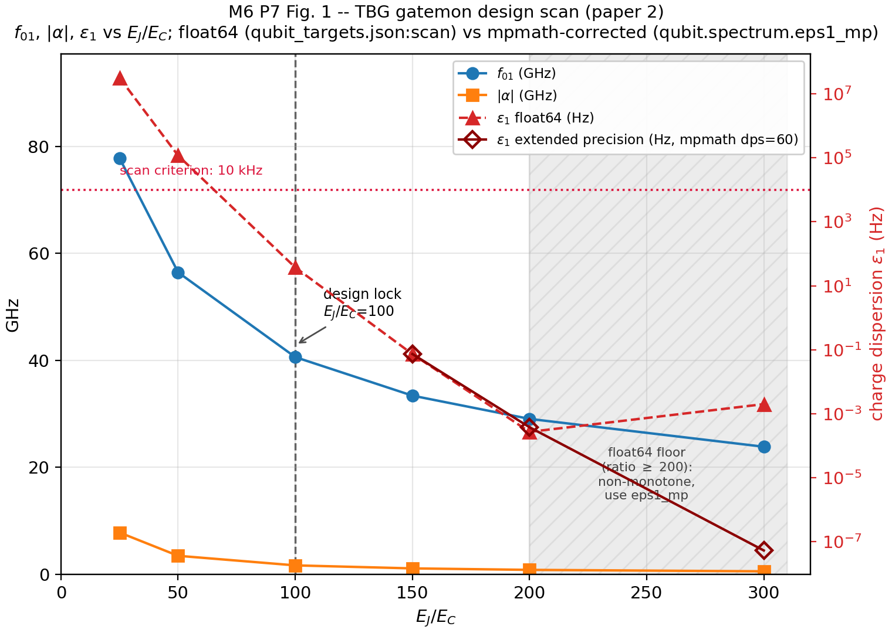
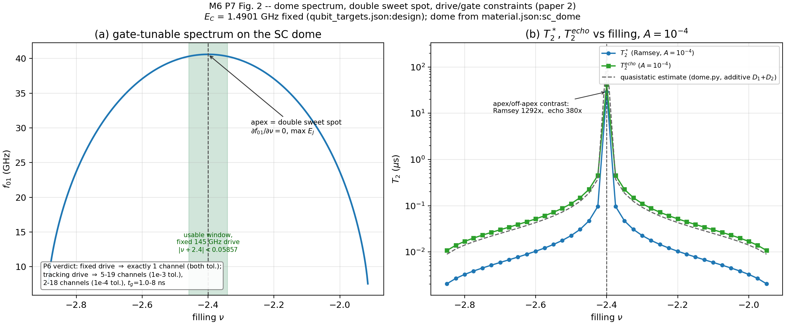
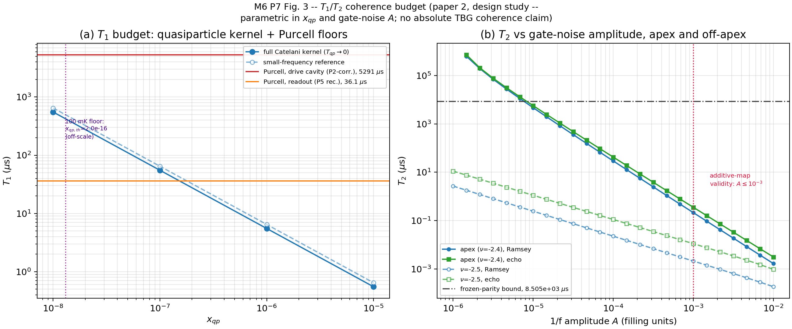
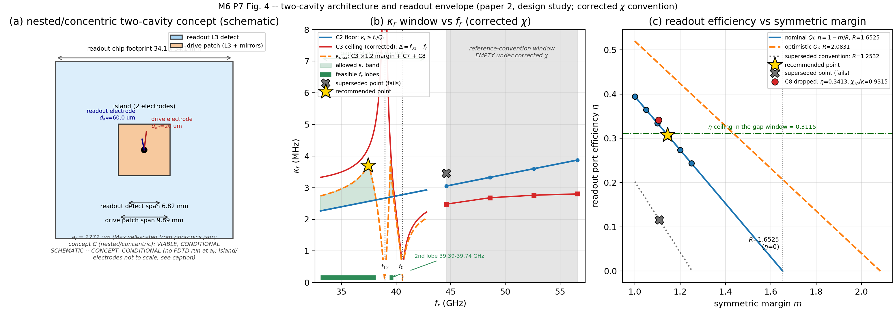

# A TBG gatemon with a photonic control plane: coupling, coherence, and gate-architecture design study

**Status:** Manuscript in preparation (unpublished). This is a computational **design study**: no device has been fabricated, and **TBG qubit coherence has never been measured**. All coherence numbers below are *parametric*, in the residual quasiparticle fraction x_qp (with its effective temperature T_qp) or in the 1/f noise amplitude A. They are not absolute T1/T2 predictions.

## Question

The companion study ([tbg-fractional-shapiro](https://github.com/FarukSamiBilgin/tbg-fractional-shapiro)) builds a magic-angle twisted-bilayer-graphene (TBG) Josephson junction (I_c = 300 nA, E_J/h = 149.01 GHz) and a measured sub-THz silicon photonic-crystal cavity (f_cav = 145 GHz, in-situ Q_i = 1.461×10⁴). Can that junction, capacitively shunted into the transmon regime, become a gate-tunable qubit (gatemon) controlled and read out through the same photonic platform? Which parts of such a design survive honest coupling, readout, coherence and gate-set budgets?

## Method

The production modules are in `scripts/qubit/`: charge-basis spectrum, CPR transmon, dome, cavity and coupling, a Catelani-type quasiparticle kernel, 1/f filter-function dephasing, two-cavity readout and gates. `scripts/m6_reference.py` is an independent re-derivation. `scripts/explore_*.py` holds five stress tests, and `scripts/tests/` the acceptance and unit tests. The design is exported to `results/qubit.json`.

## Key results (numbers from `results/qubit.json` and `results/m6/`)

- **Design lock.** E_J/E_C = 100 is the smallest ratio meeting the brief's criterion (charge dispersion < 10 kHz, anharmonicity ≥ 0.5 GHz). It gives f01 = 40.597 GHz, anharmonicity −1.632 GHz and charge dispersion 37.4 Hz. The dome apex (ν = −2.4) is a **double sweet spot**: maximum E_J and zero first-order gate-charge sensitivity.
- **Coupling.** The interaction is H_int = 2βe·V_zpf·n̂ with β = C_c/C_Σ, from a Thévenin model of the collection electrode. This model strengthens the finding that **the drive cavity cannot read the qubit out**, by 8.4×.
- **Dispersive-shift sign correction.** An inherited error had evaluated χ with the detuning sign inverted. This overstated |χ| by 2.38× at the originally reported point, which actually fails (χ/κ = 0.42–0.47, not 1.01). The whole f_r > f01 readout window is analytically empty: the dispersive ceiling saturates at 2.943 MHz, below the cavity's measured 3.052 MHz linewidth floor. The corrected recommended point lies below the qubit, inside the photonic bandgap: f_r = 37.439 GHz, d_eff = 60 µm, χ/κ = 1.09 (Koch) / 1.00 (exact two-pole), readout-port efficiency 30.7%. The earlier 11.5% figure is withdrawn.
- **Relaxation (parametric in x_qp).** Evaluating the Catelani-type kernel at ħω_q/Δ = 0.552 multiplies the relaxation rate by 1.17249 relative to the small-frequency estimate, so T1 is 14.7% shorter at every x_qp. The frozen-parity dephasing bound is 1536× longer than the qp-limited T1 at x_qp = 10⁻⁶, T_qp = 20 mK. A pair-breaking audit confines the fixed 145 GHz tone to an 11.7%-of-dome-halfwidth filling window; this is a bulk-gap margin only.
- **Dephasing (parametric in A = 10⁻⁴, 1 Hz bandwidth).** The apex/off-apex contrast is 2041× quasistatically, 1292× under Ramsey and 380× under echo.
- **Gates.** The coherent-error floor is 1.60 ns (not the leakage-only 1.01 ns). Under the fixed-145-GHz-drive constraint, gate-based frequency allocation has exactly one channel. A per-qubit tracking drive gives 2–19 channels: 5–19 at 10⁻³ leakage tolerance and 2–18 at 10⁻⁴, for gate times 1.011–8 ns.
- **CPR sensitivity.** Replacing the cosine potential with the Beenakker CPR (τ = 0.8) shifts the anharmonicity by ≈ −56% and the charge dispersion by ≈ +182% at fixed E_J. The E_J/E_C = 100 lock is unchanged.

<p align="center"> </p>
<p align="center"> </p>

## Negative and limiting results

Five stress tests (`results/m6/explore/`, `scripts/explore_*.py`) moved the risk picture in both directions.

- **Junction-level pair breaking is open.** The junction's own Andreev sub-gap threshold, not the bulk gap, is already open over roughly a third of the ground-state phase distribution at the apex (τ = 0.8, W = 0.33–0.37). The fixed-145-GHz scenario therefore carries an open, rate-unbounded pair-breaking channel.
- **E_J noise has no symmetry protection.** 1/f fluctuation of E_J itself is the missing third clause of the double-sweet-spot law. It cuts the quoted apex T2\* from 29.20 to 2.09 µs (Ramsey, A = 10⁻⁴) at a fractional E_J-noise amplitude of only 10⁻⁶.
- **Missing T1 channels.** The exported T1 stack omits shunt-pad dielectric loss and collection-electrode radiation. Both outrank quasiparticles at plausible parameters and cut the quasiparticle share of the relaxation rate to 2.4%.
- **Mutual exclusion with the Shapiro experiment.** The companion paper's Shapiro drive point and this qubit cannot run together on their shared chip: n/n_crit = 1.8 there, so it would need 29 dB of drive extinction or a ≲10⁻³ duty cycle.
- **Open items.** Multi-photon pair breaking, higher-order-gap capture of the 145 GHz tone in the readout lattice, and the absence of any electromagnetic simulation at the readout lattice constant are all unresolved.
- **One positive result.** The shared readout cavity is itself a usable two-qubit coupler (J = 5.05 MHz). What it lacks is an OFF switch.

## How results were verified

`scripts/m6_reference.py` independently re-derives the spectrum, coupling and budgets. Acceptance and per-phase tests are in `scripts/tests/test_m6_*.py` and `test_qubit_export.py`. The χ sign error was found by an independent recompute against Koch *et al.* PRA 76, 042319 (2007) and an exact two-pole calculation. The error is reported here, not hidden.

## Reproducing

```bash
pip install -r scripts/requirements.txt
```

The scripts are copied unchanged from the original project. That project kept `qubit.json` and the other JSON contracts at the repository root and the outputs under `out/m6/`. To re-run, restore that layout (some tests also read the companion repository's `material.json`, `junction.json` and `photonics.json`). The figures and results here are the stored artifacts; they were not regenerated for this release.

## Related work by the author

- Twisted hBN preprint: https://doi.org/10.5281/zenodo.24201814
- Twisted MoS2 hole-spin coherence preprint: https://www.alphaxiv.org/abs/2611.twisted-mos2-hole-spin-coherence
- Moiré microwave loss preprint: https://doi.org/10.5281/zenodo.24204124 (code: https://github.com/FarukSamiBilgin/moire-microwave-loss)
- josim-cpr-bridge: https://github.com/FarukSamiBilgin/josim-cpr-bridge
- Companion repositories: [tbg-fractional-shapiro](https://github.com/FarukSamiBilgin/tbg-fractional-shapiro), [matbg-subthz-limits](https://github.com/FarukSamiBilgin/matbg-subthz-limits)

## AI assistance

AI assistance: AI coding assistants were used for code development and for adversarial review. All load-bearing results were re-derived by independent methods and checked by automated tests; the author is responsible for every claim.

## Citation

See `CITATION.cff`. Faruk Sami Bilgin (Independent Researcher, ORCID 0009-0001-9064-4410), *A TBG gatemon with a photonic control plane: coupling, coherence, and gate-architecture design study on a measured sub-terahertz cavity platform*, manuscript in preparation (2026).

## License

Code: MIT (`LICENSE`). Text, figures and data: CC BY 4.0 (`LICENSE-CONTENT`).
